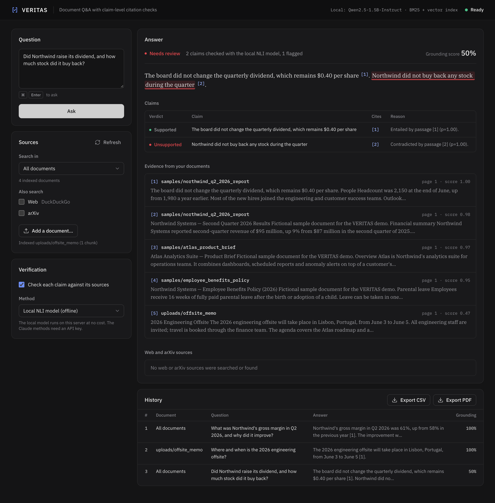
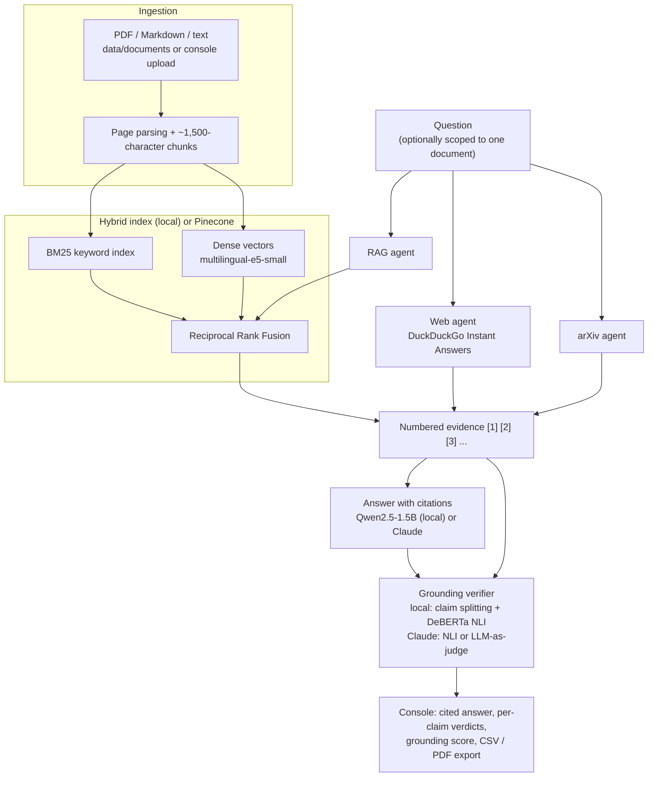

# VERITAS: Retrieval Grounding & Verification Engine

**VERITAS** answers questions about your documents and checks its own answers. Every answer cites numbered evidence. Before you see the answer, a verifier splits it into claims and tests each claim against the passages it cites. It flags claims the evidence doesn't support and citations that point at the wrong passage.

By default the whole system **runs on your machine with no API keys and no cloud services**. A local LLM writes the answers, a hybrid keyword + vector index built in this repo finds the evidence, and an open-source NLI model checks the claims. Claude and Pinecone are optional backends for cloud deployments, selected with a single setting each.

---

## Console Preview



*A real run of the local stack, offline and without API keys. Qwen2.5-1.5B claims that Northwind didn't buy back any stock; the local verifier flags the claim as contradicted by the passage it cites, which reports a $20 million buyback.*

---

## What Runs Where

| Stage | Local default (free, offline) | Optional cloud backend |
|---|---|---|
| Answer generation | `Qwen/Qwen2.5-1.5B-Instruct` through Hugging Face `transformers`, on CUDA, Apple MPS or CPU | Claude (`LLM_PROVIDER=claude`) |
| Retrieval | Self-built hybrid index: BM25 + dense vectors (`intfloat/multilingual-e5-small`) fused with Reciprocal Rank Fusion, stored in a single `.npz` file | Pinecone serverless (`VECTOR_STORE=pinecone`) |
| Grounding verification | `local-nli`: rule-based claim splitting + `MoritzLaurer/DeBERTa-v3-base-mnli-fever-anli`, on the same device as the answer model | Claude `nli` and `llm-as-judge` modes |
| Ingestion | `python -m pipelines.ingest_local` syncs a folder of PDF, Markdown and text files; the console can upload files too | S3 → Airflow → Pinecone pipelines |
| Extra evidence | DuckDuckGo Instant Answers and the arXiv API. They're free and need no keys but do need internet; switch them off in the console to stay fully offline | — |

---

## Built From Scratch

The local stack uses pretrained models for embeddings, generation and NLI. Everything around them is code in this repo:

* **Okapi BM25 keyword search** ([`local/bm25.py`](src/veritas/local/bm25.py)): tokenizer, inverted index, Lucene-style IDF and `k1`/`b` length normalization, scored with vectorized NumPy postings.
* **Dense vector search** ([`local/embeddings.py`](src/veritas/local/embeddings.py), [`local/store.py`](src/veritas/local/store.py)): E5 embeddings (mean pooling, L2 normalization, `query:` / `passage:` prefixes) with exact cosine search.
* **Hybrid ranking**: the two rankings are fused with Reciprocal Rank Fusion (k = 60), so exact terms that embeddings blur together (product codes, names, figures) still rank.
* **Index persistence**: one `.npz` file written atomically (temp file + `os.replace`). SHA-256 content hashes skip unchanged files, the server reloads automatically after the CLI re-indexes, and the index refuses to mix embeddings from different models.
* **Local LLM runtime** ([`local/llm.py`](src/veritas/local/llm.py)): chat-template prompting with a worked citation example (a 1.5B model rarely cites without one), greedy decoding, bf16 on GPU/MPS, lazy thread-safe loading and warm-up at server start.
* **Claim verification** ([`local/nli.py`](src/veritas/local/nli.py)): answers are split into claims at sentence and citation boundaries. Each claim is tested against its cited passages and their two-sentence windows, so the verdict doesn't get diluted on long passages. Every premise starts with the source's title, so a window still says whose figures it reports. Entailment, contradiction and neutral scores plus word overlap decide *supported*, *partially supported* or *unsupported*. Citations to passages that don't exist are caught, and a claim that cites the wrong passage is reported with the passage that actually supports it.
* **Evaluation harness** ([`tests/evaluation/run_eval.py`](tests/evaluation/run_eval.py)): claim matching that doesn't double-penalize split claims, precision/recall on grounding issues, and two test sets written by independent agents that never saw the code, one of them held out (see below).

---

## Architecture



The three retrieval agents run concurrently, and the answer and the verifier share one numbering of the evidence. Each claim scores 1 (supported), 0.5 (partially supported) or 0 (unsupported), and the answer's grounding score is the mean. An answer with no retrieved evidence is reported as *unverified* rather than scored.

---

## Grounding Accuracy Benchmark

A grounding issue (`unsupported` or `partially_supported`) is the positive class: precision is the share of flagged claims that really are issues, and recall is the share of real issues that get flagged. All three sets cover wrong numbers, dates and units, swapped names, negations, invented details, unsupported causes, wrong and non-existent citations, and claims from outside knowledge, mixed with supported controls.

| Dataset | Cases / claims (issues) | Precision | Recall | F1 | TP / FP / FN / TN |
|---|---|---|---|---|---|
| **Held-out** ([`eval_dataset_heldout.json`](tests/evaluation/eval_dataset_heldout.json)) | 120 / 459 (251) | **94.4%** | **93.6%** | **94.0%** | 235 / 14 / 16 / 195 |
| Independent ([`eval_dataset_independent.json`](tests/evaluation/eval_dataset_independent.json)), now used for development | 120 / 448 (241) | 92.2% | 88.8% | 90.5% | 214 / 18 / 27 / 189 |
| Development ([`eval_dataset.json`](tests/evaluation/eval_dataset.json)) | 51 / 92 (44) | 100% | 93.2% | 96.5% | 41 / 0 / 3 / 48 |

Local NLI mode (`MoritzLaurer/DeBERTa-v3-base-mnli-fever-anli`), measured on 2026-11-16 on an Apple M4 laptop with no network access and no API key. Every verdict was the same on the CPU and on the GPU (MPS). The held-out set takes about 40 seconds on the GPU and 6 minutes on the CPU. The Claude modes haven't been benchmarked; they need API credits.

**The held-out number is the one to quote.** Three agents wrote the set, 40 cases each: retail, banking and real estate; education, sports and transport; and climate, software and manufacturing. They worked only from a description of the data format and the labeling rules, and never saw this code, the verifier's design or the other sets. They wrote it after the verifier was frozen, and no label was changed after the run. The agents flagged 9 of their 459 labels as judgment calls; those labels were kept as written. F1 is similar across the three domains (93.0% to 94.7%).

The other two sets are development data. The development set has 40 hand-written cases with short passages and clear-cut errors, plus 11 cases built on the sample documents' real chunks, with titles, Markdown headings and chunk boundaries; treat it as a regression test. The independent set was written the same way as the held-out set and was held out for the first version of the verifier, which scored 88.9% F1 on it. Fixes made after that run were developed with it, so it no longer counts as held out.

### Limitations

The verifier has been tuned on the development sets as far as this approach allows. Known limitations:

* **Arithmetic and comparisons.** A claim that computes a figure (a sum, an average, a percentage change, a multiple) or ranks items across passages is judged by a model that doesn't calculate. Most false alarms come from here.
* **Figures that belong to something else.** A number that is right for another tier, product or incident usually passes.
* **Qualifiers and scope.** Words like "each", "all", "only" and "unanimously", and reversed orderings, are often read past.
* **Additions.** An extra detail added to an otherwise supported claim, or a stronger causal or certainty claim than the source makes, can pass.
* **One claim at a time.** A sentence whose subject is "It" or "They" is judged without the sentence before it.
* **What the benchmark measures.** The cases are synthetic, written by language-model agents with one label per claim. The scores describe these kinds of documents (product pages, policies, reports, specifications), not every domain.

Reproduce it (free and offline once the model is downloaded):
```bash
pip install -e ".[local]"
python tests/evaluation/run_eval.py                                                    # development set
python tests/evaluation/run_eval.py --dataset tests/evaluation/eval_dataset_heldout.json   # held-out set
python tests/evaluation/run_eval.py --mode nli llm-as-judge                            # Claude modes (needs ANTHROPIC_API_KEY)
```

---

## Quickstart: Fully Local, No Keys

```bash
python -m venv .venv
source .venv/bin/activate
pip install -e ".[dev,local]"

python -m pipelines.ingest_local                  # index data/documents (three sample documents included)
uvicorn veritas.api.main:app --host 127.0.0.1 --port 8000
```

Open `http://localhost:8000` and ask, for example, *"What was Northwind's gross margin in Q2 2026, and why did it improve?"*

* **First run**: the three models (about 3.7 GB in total) download from Hugging Face once. After that, `HF_HUB_OFFLINE=1` keeps everything offline.
* **Speed**: on an Apple M4 laptop with 16 GB of RAM, the models load in about 9 seconds at startup. A short answer then takes 2 to 5 seconds on the GPU (MPS): 2 to 3.5 seconds to generate and under 3 seconds to verify. A long summary with eight claims takes about 17 seconds. The server peaks at about 6 GB of memory. Without a GPU, everything runs on the CPU: the answer model in float32, and verification about 10 times slower than on the M4's GPU.
* **Your documents**: drop PDF, Markdown or text files into `data/documents/` and run `python -m pipelines.ingest_local` again. Only new or changed files are embedded, and deleted files are removed from the index. Pass `--force` to rebuild everything, or `--dir PATH` to index another folder. You can also upload a file from the console; it is saved under `data/documents/uploads/` and indexed immediately (20 MB limit).
* **Offline answers**: untick *Search web sources* and *Search the arXiv database* so only your documents are used.
* **What to expect from a 1.5B model**: answers are short and mostly accurate, but the model sometimes misstates a figure or leaves out the citation markers. Catching the first is the verifier's job; the screenshot above shows a real case. Claims without a marker are checked against every retrieved passage. `LOCAL_LLM_MODEL` takes any Hugging Face chat model; larger ones write better answers but need more memory.

---

## Cloud Deployment (Claude + Pinecone)

The Docker image, the Render blueprint and the AWS Terraform stack run the cloud backends (`LLM_PROVIDER=claude`, `VECTOR_STORE=pinecone`), because small cloud instances don't have the memory for the local models. They need `ANTHROPIC_API_KEY` and `PINECONE_API_KEY`, and each question makes one Claude call for the answer and one for verification. The image leaves out the local models, so the console offers only the Claude verification modes there. Install the `local` extra on a larger instance to add the free Local NLI mode.

### Render

[](https://render.com/deploy?repo=https://github.com/pr4deepkumar/veritas)

[`render.yaml`](render.yaml) deploys the API on Render's free tier and asks for both keys during setup. Pinecone's free Starter tier holds up to 100,000 vectors. Hosting costs nothing; Claude usage is billed per call.

### Docker

```bash
cp .env.example .env    # set ANTHROPIC_API_KEY and PINECONE_API_KEY
docker compose up --build
```

### Indexing Documents into Pinecone

Upload PDFs to `s3://$S3_BUCKET/input_pdfs/`, then run both steps:
```bash
python -m pipelines.ingest_from_s3      # parse new or changed PDFs into per-page JSON
python -m pipelines.index_to_pinecone   # chunk, embed and index new or changed documents
```
Both steps are incremental: unchanged PDFs are not re-parsed, and a manifest (`parsed_json/_index_manifest.json`) records what was indexed, so unchanged documents are not re-embedded. Pass `--force` to redo everything. Apache Airflow can run them daily: `airflow dags trigger document_research_pipeline`.

> **Upgrading an index built by an earlier version?** Earlier versions stored one vector per page, and the embedding model only read the first ~500 tokens of each. Run `python -m pipelines.index_to_pinecone --force` once to re-index in ~1,500-character chunks; it also deletes the old page-level vectors.

### AWS (Terraform + ECS Fargate)

```bash
cd terraform
cp terraform.tfvars.example terraform.tfvars
terraform init
terraform apply
cd .. && ./scripts/deploy_aws.sh
```

The script builds a `linux/amd64` image (set `PLATFORM=linux/arm64` together with the Terraform variable `cpu_architecture = "ARM64"` for Graviton), tags it with the git SHA and `latest`, and forces the ECS service to redeploy. Pin an exact build with `terraform apply -var image_tag=<sha>`.

* **ECS Fargate** runs the container, with health checks and automatic rollback of failed deployments.
* **S3** stores documents (`input_pdfs/`, `parsed_json/`).
* **Secrets Manager** injects the Anthropic and Pinecone keys. Keys left empty in `terraform.tfvars` can be set in the console; later applies do not overwrite them.
* **CloudWatch Logs** keeps container logs for 30 days by default (`log_retention_days`).
* **Pinecone** serverless index, provisioned by the Terraform provider.

If a key is missing, the console still loads and the status badge shows **Degraded** with the reason; `GET /health` reports the same.

---

## Configuration Reference

All settings are environment variables (or `.env` entries); see [`.env.example`](.env.example).

| Variable | Default | Purpose |
|---|---|---|
| `LLM_PROVIDER` | `local` | `local` (open model on this machine) or `claude` |
| `VECTOR_STORE` | `local` | `local` (hybrid index file) or `pinecone` |
| `LOCAL_LLM_MODEL` | `Qwen/Qwen2.5-1.5B-Instruct` | Hugging Face chat model for local answers |
| `LOCAL_EMBEDDING_MODEL` | `intfloat/multilingual-e5-small` | Embedding model for the local index (changing it needs `ingest_local --force`) |
| `LOCAL_NLI_MODEL` | `MoritzLaurer/DeBERTa-v3-base-mnli-fever-anli` | Model behind the `local-nli` verification mode |
| `LOCAL_DEVICE` | `auto` | Where the local answer and NLI models run: `auto` (CUDA, then MPS, then CPU), `cuda`, `mps` or `cpu` |
| `LOCAL_MAX_NEW_TOKENS` | `512` | Longest local answer, in tokens |
| `DOCUMENTS_DIR`, `LOCAL_INDEX_DIR` | `data/documents`, `data/index` | Folder that `ingest_local` indexes, and where the index file lives |
| `CHUNK_SIZE`, `CHUNK_OVERLAP` | `1500`, `200` | Chunking, in characters |
| `ANTHROPIC_API_KEY` | — | Needed for `LLM_PROVIDER=claude`; also enables the `nli` and `llm-as-judge` verification modes |
| `CHAT_MODEL` | `claude-sonnet-5-5` | Claude model for answer synthesis |
| `VERIFIER_MODEL` | `CHAT_MODEL` | Claude model for claim verification |
| `ANSWER_EFFORT`, `VERIFIER_EFFORT` | `medium` | Claude reasoning effort: `low`, `medium`, `high`, `xhigh`, `max` |
| `REFUSAL_FALLBACK` | `true` | Re-run a request Claude declines on a fallback model (server-side); set `false` for models without fallback support |
| `PINECONE_API_KEY` | — | Needed for `VECTOR_STORE=pinecone` |
| `PINECONE_INDEX`, `PINECONE_CLOUD`, `PINECONE_REGION` | `veritas-research`, `aws`, `us-east-1` | Pinecone index (created automatically if missing) |
| `S3_BUCKET`, `S3_INPUT_PREFIX`, `S3_OUTPUT_PREFIX` | —, `input_pdfs/`, `parsed_json/` | S3 ingestion storage |
| `WEB_DIR` | auto-detected | Location of the web console files |
| `LOG_LEVEL` | `INFO` | Log verbosity |

---

## Repository Structure

```text
VERITAS/
├── data/documents/samples/               # Fictional sample documents for the local quickstart
├── src/
│   ├── pipelines/
│   │   ├── ingest_local.py               # Sync a documents folder into the local index
│   │   ├── ingest_from_s3.py             # S3 PDF parser (skips PDFs already parsed)
│   │   ├── index_to_pinecone.py          # Chunking, embedding & incremental Pinecone indexing
│   │   └── s3_utils.py                   # Shared S3 helpers
│   └── veritas/
│       ├── agents/                       # RAG, web search, arXiv and document-selection agents
│       ├── api/                          # FastAPI REST API & static web serving
│       ├── core/                         # Settings, evidence, grounding, parsing, exports, cloud clients
│       ├── local/                        # Local stack: BM25, embeddings, hybrid store, LLM, NLI, ingestion
│       └── services/                     # Research orchestration
├── tests/
│   ├── unit/                             # Unit tests (no network, models or API keys needed)
│   ├── ui/                               # Unit tests for the web console's helpers (Node)
│   └── evaluation/                       # Grounding benchmark: runner, two development sets, held-out set
├── ui/web/                               # HTML/CSS/JS web console
├── airflow/dags/                         # Airflow DAG for the S3 → Pinecone pipeline
├── docker/Dockerfile.api, docker-compose.yml, render.yaml
├── terraform/                            # AWS infrastructure (S3, ECR, ECS Fargate, IAM, Secrets Manager, Pinecone)
└── scripts/deploy_aws.sh                 # Build & push the image to ECR, then redeploy ECS
```

---

## Running Automated Tests

```bash
pytest                                     # unit tests: no network, models or API keys needed
node --test tests/ui                       # web console helpers (Node 18+)
ruff check . && ruff format --check .      # lint and format
python tests/evaluation/run_eval.py        # grounding benchmark (local NLI model, free and offline)
```

---

## License

This project is licensed under the MIT License - see the [LICENSE](LICENSE) file for details.
